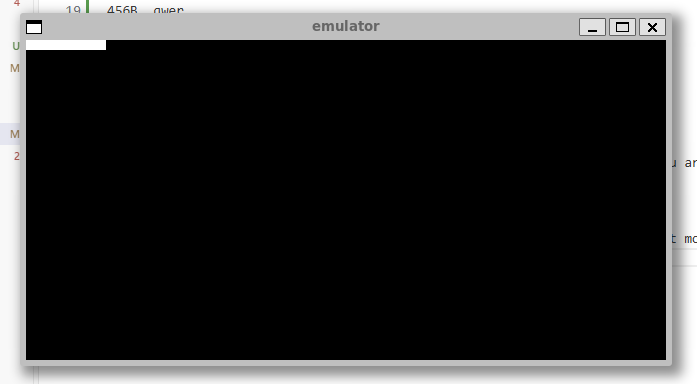

# terra6

This ~~is~~ was a CHIP-8 emulator.
CHIP-8 is an interpreted programming language (although it look much like assembly)
that is very simple but also very constrained.
For one, there is only enough memory to fit in about a thousand instructions,
and that's if you don't include data (which you probably will if you want
to draw to the screen)!

The program ~~is~~ should have been an interpreter for the language.
It takes a file of all the code/data to be put at the start of the program,
and it includes usage of a display screen and a keyboard.

The keyboard emulated has 16 keys, so
there is a keymapping from a QWERTY keyboard to it:
```
hex <-qwer
123A  1234
456B  qwer
789C  asdf
D0EF  zxcv
```

How to play:
- install the executable in the release from Github
- `chmod +x` it
- make sure that there's a .ch8 file named `file.ch8` in the directory you are running the executable.
	this will be the ROM that will be loaded.
- `./` it!

At one point I thought that the app was completely broken. But, with a bit more critical thinking...



The emulator still misses the mark on a few commands, but at least it can draw.
It doesn't have audio, but it does have a timer for it. There is also a normal delay timer.
